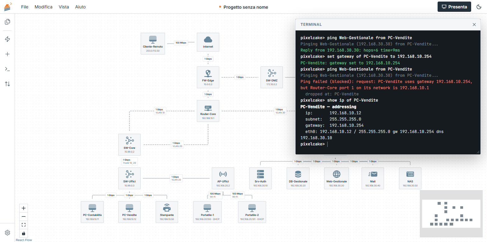

# 🍰 PixelCake

**Infrastructure, piece by piece.**

PixelCake is a browser-based designer for small networks. You draw the network, configure it, then ask it a question: does this PC reach that server? If it does not, you see where the traffic stops and why.



**Status:** early prototype. It is good for exploring and explaining a small network. Do not use its answers to validate a real one: the [limits](#what-it-does-not-do) are listed below.

## What it does

- **Draw.** Devices, links, VLANs, ports and network cards on an interactive canvas. 20 device types and 5 link types are built in and can be customised. Auto-layout, multi-selection, copy and paste, and several boards per project.
- **Test.** Ping, web, download and email flows are checked hop by hop and animated on the drawing. When a flow fails, the packet stops at the device that blocks it and the reason is shown.
- **Type.** A built-in terminal with a small vendor-neutral command language: `ping`, `trace`, `show`, `set`, `connect`, `add vlan` and a few more. Commands that change the network edit the same drawing you see.
- **Save.** A project, with all its boards, is kept in the browser while you work and saved as a single `.pixelcake.json` file that you can open again or pass on. There is no server and no account.
- **Export.** The topology as YAML, which can be loaded back. A Terraform-style export exists only as a sketch.

The interface is in Italian. The terminal language is English.

### The terminal

Output on the bundled sample network (two subnets, one router):

```text
pixelcake> ping Web-01 from PC-1
Pinging Web-01 (192.168.20.10) from PC-1...
Reply from 192.168.20.10: hops=5 time=7ms

pixelcake> set gateway of PC-1 to 192.168.10.254
PC-1: gateway set to 192.168.10.254

pixelcake> ping Web-01 from PC-1
Pinging Web-01 (192.168.20.10) from PC-1...
Ping failed (blocked): request: PC-1 uses gateway 192.168.10.254, but Router-1 port 1 on its network is 192.168.10.1
  dropped at: PC-1
```

The full command reference is in [docs/terminal-commands.md](docs/terminal-commands.md).

### What the check looks at

The engine walks the shortest path between two devices and applies these rules in order:

1. Both endpoints exist and have a valid IPv4 address.
2. A physical path exists.
3. No disabled port or network card at either end of a link on the way.
4. VLAN membership on the switches crossed.
5. Across subnets: a router or firewall is on the path, and the source's gateway is the address of the router port the packet arrives on.
6. Firewall security zones. A new flow from a less trusted zone is denied; the reply to an allowed flow passes.

Every link is attached to a port or a network card at both ends, chosen automatically when you draw it and editable afterwards. Router and firewall ports carry their own addresses.

When the engine cannot verify something, it says so in a note instead of answering "it works". The engine is plain TypeScript with no UI dependencies, in [frontend/src/engine](frontend/src/engine). The same network always gives the same answer.

## What it does not do

- **It is not a packet-level simulator.** There is no ARP, MAC learning, routing table, spanning tree, NAT or ACL. Ping times are synthetic.
- **It only tries the shortest path.** If that path is blocked, it does not look for another one.
- **It only checks the first router.** With more than one router on the path, routing between them is assumed and the result says so.
- **Firewall rules are a fixed table of zones.** You cannot write your own rules yet.
- **Some settings are stored but not evaluated:** STP, NAT and per-port VLANs.
- **No undo, no image export.** Both are in the menu, disabled.
- **The YAML format is PixelCake's own.** Device names that look like numbers or booleans, and duplicate names, do not survive an export and import.
- **The Terraform export cannot be applied.** It uses placeholder resource types and no provider. Reading existing Terraform state is not implemented.
- **No accounts, no sharing.** A project is a file on your disk. Two browser tabs open on the same project do not see each other's changes: the last one to write wins.

## Run it

You need Node 22 with pnpm 10.

```bash
cd frontend
pnpm install
pnpm dev
```

Open `http://localhost:5173`. Everything runs in the browser: there is nothing else to start.

Your work is kept in the browser's storage, so it is still there after a reload. To keep it for good, or to move it to another computer, save the project to a file with **File → Salva** (Ctrl+S). In Chrome and Edge the file is written in place; in other browsers it is downloaded. The format is described in [docs/project-file.md](docs/project-file.md).

The app's icons are bundled with it. Only an icon name typed by hand in a custom device template is fetched from the Iconify API.

## Development

```bash
cd frontend
pnpm test:run      # 629 tests: engine, terminal, project files, import/export, screens
pnpm type-check
pnpm lint
pnpm build
```

GitHub Actions runs the same four steps on every push.

```
frontend/src/
  engine/       reachability check and flow models (pure TypeScript)
  terminal/     command parser and executor
  components/   canvas, panels, windows
  store/        application state (Zustand, persisted in the browser)
  utils/        auto-layout, IP helpers, project files, import and export
docs/           terminal command reference, project file format
```

Built with React 19, TypeScript, Vite, React Flow, Zustand and Tailwind CSS. More detail in [ARCHITECTURE.md](ARCHITECTURE.md).

## Where it is going

PixelCake started from one idea: a single place to **design** an infrastructure, **test** it, and hand it to automation as **code** (Terraform, YAML), so that the people who draw networks and the people who automate them work on the same thing.

Today the first two exist in a basic form and the third is only a sketch. The steps below are ordered to get there for real: an export can only be as correct as the model behind it.

## What is next

1. Undo and redo.
2. Export the drawing as an image.
3. Routing tables, ARP and per-port VLANs, so the check can follow a packet across more than one router.

## License

Copyright © 2025–2026 [@Phil-pje](https://github.com/Phil-pje).

PixelCake is released under the GNU Affero General Public License v3.0. See [LICENSE](LICENSE).

The bundled icons keep their own licences: Material Design Icons (Apache 2.0), Lucide (ISC), Carbon (Apache 2.0) and Solar (CC BY 4.0, by 480 Design), obtained through [Iconify](https://iconify.design).

## Contact

Open an issue, or write to pixelcake.dev@gmail.com.
