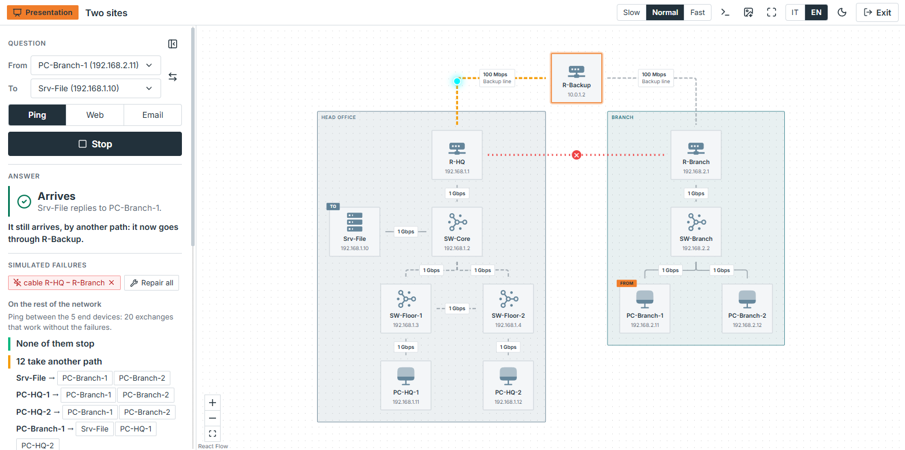
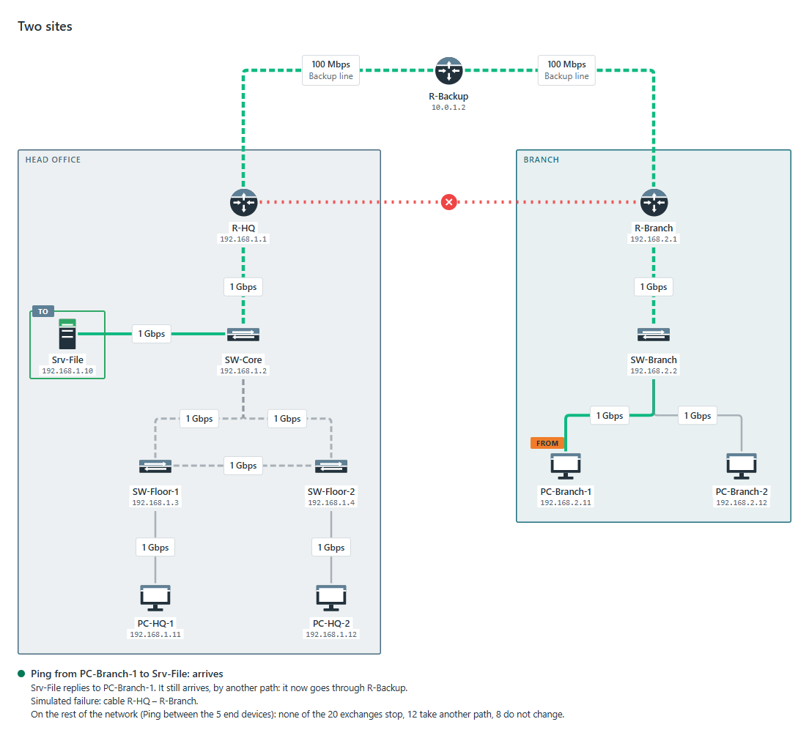

# 🍰 PixelCake

**Infrastructure, piece by piece.**

PixelCake is a browser-based designer for small networks. You draw the network, configure it, then ask it a question: does this PC reach that server? If it does not, you see where the traffic stops and why.


**Status:** early prototype. It is good for exploring and explaining a small network. Do not use its answers to validate a real one: the [limits](#what-it-does-not-do) are listed below.

## What it does

- **Draw.** Devices, links, ports and network cards on an interactive canvas. 20 device types and 5 link types are built in and can be customised. Auto-layout, multi-selection, copy and paste, and several boards per project.
- **Configure.** Addresses on every router port and network card, static routes, VLANs port by port (access and trunk), firewall zones and ordered rules, NAT towards the Internet and port forwards for what is reached from it.
- **Test.** Ping, web, download and email flows are followed hop by hop and animated on the drawing. When a flow fails, the packet stops at the device that drops it and the reason names the port, the route or the rule.
- **Type.** A built-in terminal with a small vendor-neutral command language: `ping`, `trace`, `browse`, `show routes`, `add route`, `add rule`, `interface 3 access 10` and more. Commands that change the network edit the same drawing you see.
- **Present.** A presentation mode puts the editing tools away. Click two devices to ask a question, watch the packet go, read the answer hop by hop. Then break something, a device or a cable, and see at once whether the traffic finds another way and which exchanges between end devices stop working. Nothing in the drawing changes.
- **Save.** A project, with all its boards, is kept in the browser while you work and saved as a single `.pixelcake.json` file that you can open again or pass on. There is no server and no account.
- **Hand over.** The board as a picture, PNG or SVG, in the light or the dark theme, to a file or to the clipboard. Made from a presentation, it carries the question, the answer and what was broken.
- **Export.** The topology as YAML, which can be loaded back. A Terraform-style export exists only as a sketch.

The interface is in Italian. The terminal language is English.

Four sample networks are bundled. The welcome screen loads the first: a small company, with offices and Wi-Fi in two VLANs on one trunk, an access point, a switch of servers, a public portal in a DMZ and a firewall with three rules that does NAT towards the Internet. It is also under Aggiungi → Topologie, with the other three: a small office with two subnets and a router; a site with VLANs, a DMZ and a firewall; and two sites joined by a main line and a backup line, made for trying failures.

### The terminal

Output on the small office sample (Aggiungi → Topologie → «Ufficio: due reti e un router»):

```text
pixelcake> ping Web-01 from PC-1
Pinging Web-01 (192.168.20.10) from PC-1...
Reply from 192.168.20.10: hops=5 time=7ms

pixelcake> set gateway of PC-1 to 192.168.10.254
PC-1: gateway set to 192.168.10.254

pixelcake> ping Web-01 from PC-1
Pinging Web-01 (192.168.20.10) from PC-1...
Ping failed (blocked): request: PC-1 uses gateway 192.168.10.254, but Router-1 port 1 on its network is 192.168.10.1
  dropped at: PC-1
```

Routing, VLANs and firewall rules are configured the same way, and every answer says which device decided what:

```text
pixelcake> add route 192.168.30.0/24 via 10.0.0.2 on Router-1
Router-1: route to 192.168.30.0/24 via 10.0.0.2 added

pixelcake> trace Branch-PC from PC-1
Tracing route to Branch-PC (192.168.30.11) from PC-1:
  1  ○ PC-1 (PC)
  2  ○ SW-Office (Switch)
  3  ○ Router-1 (Router)  — routed: 192.168.30.0/24 via 10.0.0.2 (port 3)
  4  ○ Router-2 (Router)  — routed: 192.168.30.0/24 is on port 2
  5  ● Branch-PC (PC)
Trace complete: destination reached.

pixelcake> add rule allow web from untrust to Web-01 on FW-1
FW-1: rule 1 added — allow web from untrust to 192.168.20.10
  Web-01 → 192.168.20.10

pixelcake> ping Web-01 from Ext
Pinging Web-01 (192.168.20.10) from Ext...
Ping failed (blocked): request: firewall FW-1: no rule matches, zone policy untrust → trust denied
  dropped at: FW-1
```

The full command reference is in [docs/terminal-commands.md](docs/terminal-commands.md).

### How a packet is followed

The engine carries a packet the way the network would. At every device that handles it:

1. **Routing.** The device looks the destination up in its routing table: a network one of its interfaces is in, a static route, or its default gateway. The most specific entry wins. No entry, no way: "no route", "no default gateway".
2. **Filtering.** A firewall in transit applies its rules top to bottom; the first that matches decides. When none matches, the zone policy does: a new flow towards a more trusted zone is denied. The reply to an allowed flow passes.
3. **Delivery.** The packet goes to the next address across switches, VLAN by VLAN: a switch port is an access port in one VLAN or a trunk carrying several, and once a switch has a VLAN on any port the ports nobody touched are in VLAN 1, as on real hardware. The shortest way that works is taken, so a port that is down is gone round when the drawing offers another way.

A routing loop, an address used twice, a next hop nobody has, a trunk towards a device that expects no tag: each stops the packet with its own explanation.

### What happens if this breaks



In presentation mode a click on a device or on a cable takes it as broken. The drawing is not edited: the failure is a list handed to the engine next to the network, and it is gone when the presentation ends. The question on screen is asked again at once.

- A device that is down sends and takes nothing; a cable that is cut carries nothing. The reason of a failed answer names them: `SW-Core is down`, `link R-Sede–R-Filiale is down`.
- Between switches the engine takes the shortest way that still works, so a ring or a second cable carries the traffic.
- A router, or a host with two network cards, stops using a route when the interface it leaves by has no working cable left, and takes the next route for that destination: a backup route written after the main one. The answer says so in a note.
- The panel then counts, over every pair of end devices: how many exchanges stop, how many take another way, how many do not notice. A click on one of them asks that question.

The terminal sees the same failures while the presentation lasts, so a `ping` typed there agrees with the picture.

Every link is attached to a port or a network card at both ends, chosen automatically when you draw it and editable afterwards.

When the engine cannot verify something, it says so in a note instead of answering "it works": a router whose ports have no address (it still lets traffic through, so drawings made before routing existed keep working), the Internet symbol, NAT. The engine is plain TypeScript with no UI dependencies, in [frontend/src/engine](frontend/src/engine). The same network always gives the same answer.

### The drawing as a picture



**File → Esporta immagine…** draws the whole board again as a picture. It is not a screenshot: it is made from the same data as the canvas, so it shows every device whatever the zoom, and never a selection or a connection point.

- **PNG**, at one, two or three times the size of the screen, for documents, slides and messages; or **SVG**, a vector file that stays sharp at any size, with its texts still texts.
- Light or dark, whatever the screen shows. The name of the project can be written above the drawing, and the background left out.
- To a file, or to the clipboard where the browser allows it.

Opened from a presentation (the picture button on its bar), it shows what the presentation shows: the two ends of the question, the cables the answer travels on, what is broken. Under the drawing it writes the question, the answer, the simulated failures and what they do to the rest of the network. The picture above is the screen of the previous section, exported.

## What it does not do

- **It is not a packet-level simulator.** There is no ARP, MAC learning, DHCP, DNS or dynamic routing. Ping times are derived from the number of hops.
- **Routes are static.** A router knows the networks it is attached to and the routes you wrote. Router sub-interfaces are not modelled: routing between VLANs needs a router port in each.
- **A backup route takes over only when the line is seen to be down.** That is, when the interface of the main route has no working cable left. A next hop that dies behind a switch is not noticed, as with a plain static route on real hardware, and the traffic is lost there. A host has one gateway per network card: there is no gateway redundancy protocol.
- **Simulated failures are not saved.** They belong to the presentation and are gone when it ends.
- **Firewall rules know three services**: ping, web and email. There are no port numbers, and traffic addressed to the firewall itself is not filtered.
- **Spanning tree is not simulated.** A drawing with redundant links is walked without loops, but no port is blocked.
- **NAT is by service, not by port number.** A port forward is "this service, arriving on this port": there are no TCP or UDP port numbers, and two flows never compete for a translation. A server reached from inside at its published address is not treated apart, and a device behind two layers of NAT is found by name only through the first.
- **The Internet symbol is a stand-in.** It carries public addresses, with a note, and refuses private ones, as the Internet does. A Cloud symbol with any other name carries everything, with a note.
- **No undo.** It does not exist yet.
- **A picture is one board.** A project with several boards is exported one board at a time. The SVG names the fonts of the interface without embedding them: on a computer that has none of them the texts are set in another typeface. A PNG of a very large drawing is reduced to what the browser can paint, and the dialog says so.
- **The YAML format is PixelCake's own.** Device names that look like numbers or booleans, and duplicate names, do not survive an export and import.
- **The Terraform export cannot be applied.** It uses placeholder resource types and no provider. Reading existing Terraform state is not implemented.
- **No accounts, no sharing.** A project is a file on your disk. Two browser tabs open on the same project do not see each other's changes: the last one to write wins.

## Run it

You need Node 22 with pnpm 10.

```bash
cd frontend
pnpm install
pnpm dev
```

Open `http://localhost:5173`. Everything runs in the browser: there is nothing else to start.

Your work is kept in the browser's storage, so it is still there after a reload. To keep it for good, or to move it to another computer, save the project to a file with **File → Salva** (Ctrl+S). In Chrome and Edge the file is written in place; in other browsers it is downloaded. The format is described in [docs/project-file.md](docs/project-file.md).

The app's icons are bundled with it. Only an icon name typed by hand in a custom device template is fetched from the Iconify API.

## Development

```bash
cd frontend
pnpm test:run      # 1694 tests: engine, terminal, project files, import/export, pictures, screens
pnpm type-check
pnpm lint
pnpm build
```

GitHub Actions runs the same four steps on every push.

```
frontend/src/
  engine/       routing, VLANs, firewall, flow models, failures (pure TypeScript)
  terminal/     command parser and executor
  components/   canvas, panels, windows
  store/        application state (Zustand, persisted in the browser)
  utils/        auto-layout, IP helpers, project files, import and export, pictures
docs/           terminal command reference, project file format
```

Built with React 19, TypeScript, Vite, React Flow, Zustand and Tailwind CSS. More detail in [ARCHITECTURE.md](ARCHITECTURE.md).

## Where it is going

PixelCake started from one idea: a single place to **design** an infrastructure, **test** it, and hand it to automation as **code** (Terraform, YAML), so that the people who draw networks and the people who automate them work on the same thing.

Today the first two exist in a basic form and the third is only a sketch. The steps below are ordered to get there for real: an export can only be as correct as the model behind it.

## What is next

1. Undo and redo.
2. In the engine: DHCP and DNS, then spanning tree.

## License

Copyright © 2025–2026 [@Phil-pje](https://github.com/Phil-pje).

PixelCake is released under the GNU Affero General Public License v3.0. See [LICENSE](LICENSE).

The bundled icons keep their own licences: Material Design Icons (Apache 2.0), Lucide (ISC), Carbon (Apache 2.0) and Solar (CC BY 4.0, by 480 Design), obtained through [Iconify](https://iconify.design).

## Contact

Open an issue, or write to pixelcake.dev@gmail.com.
