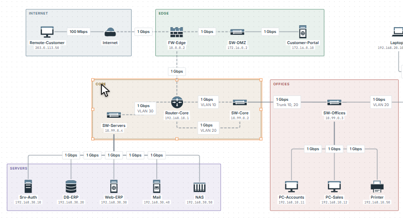

An area is a coloured rectangle with a short name in a corner, drawn behind a group of devices to say what they are: Core, Edge, Offices, Internet. It is there for whoever reads the drawing. The sample networks come with theirs, all but the small office.

## What an area is {#what}

An area is a drawing and nothing else. No device belongs to it: moving an area moves no device, and moving a device does not move the area. The engine never reads it, so a PC drawn inside an area called Servers is not in any server network, and an address, a VLAN or a rule does not follow the colour. Two things look at where a device is drawn: the [automatic layout](layout-and-connection.md#layout), which keeps the devices of an area together and draws the area again around them, and [the automatic connection](layout-and-connection.md#connect), which prefers a switch of the same area.

An area is light, so that it is not in the way: devices and cables are drawn over it, a selection box drawn on it takes the devices and never the area, and selecting, copying, pasting and deleting devices work as they do without it.

## Adding one {#add}

There are two ways:

- In the bar on the left press “Add device”, and in the panel “Add” choose “Area”. An area is added at the centre of the part of the board you are looking at.
- Select the devices it is for, and choose Edit → “Enclose in an area”, or right click one of them and choose “Enclose in an area”. The area is drawn around the selected devices, with room for its name. Where that room would cross another area, or cover a device that is not in the selection, it gives way, down to a small margin; an area made inside another stays inside it.

Either way the new area is selected and its name is open for typing. Type the name and press Enter. A name is up to 40 characters, with extra spaces taken out. An area with no name is shown as “Unnamed”. The area gets a colour of its own: of the six, the one used the least on the board so far.

## Moving, resizing, renaming {#edit}

- **Select** an area with a click on its name or on its border. The inside does not take the press, so that the devices in it can be reached.
- **Move** it by dragging its name or its border. The devices stay where they are.
- **Resize** it with the eight handles it shows when it is selected. It cannot be made smaller than 120 by 80.
- **Rename** it with a double click on its name, or right click → “Rename”. “Area name” is the field in which you type; Enter keeps the name, Esc leaves it as it was.
- **Colour**: right click → “Colour”, and pick one of six: Slate, Green, Ochre, Red, Purple, Teal.
- **Delete**: the Delete key, or right click → “Delete”, which asks first. The devices it encloses stay where they are.

Areas belong to their board: they stay with it when you go to another board of the project and back, and they are saved in the project file. The YAML export has no places, and it does not carry them. A presentation shows the areas and lets nothing be done to them; the small map shows them as faint rectangles, and the exported image draws them, in light and in dark.

## Showing and hiding them {#show-hide}

View → “Show areas” hides the areas and shows them again. It is marked when on, which it is at first. The choice is a preference of this browser, kept with the theme: the drawing and the project file are not touched. Hidden, the areas are not drawn on the board, in its small map, in a presentation or in the exported image; they cannot be selected, moved or resized, and the Delete key does not reach them. Making a new area shows them again, and a notice says so.

## Limits {#limits}

> [!LIMITS]
> - An area is not a network, a site or a VLAN: it has no address and no settings, and the engine does not read it.
> - One area may be drawn inside another, and the automatic layout keeps it there; that is all it means.
> - The YAML export does not carry areas.
