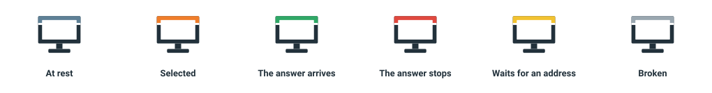

A device is one piece of the drawing: a PC, a switch, a router, a server. Each is drawn with its name under it and, below the name, its address. A device is made from a template, and PixelCake comes with 24 of them, one for each kind below. Anything the engine decides, from whether a packet crosses a device to which address a name stands for, starts from what is written on the devices and on the cables between them.

## The 24 kinds {#kinds}

The kinds differ in two ways: whether the device has numbered ports or network cards, and what the engine does with traffic that is not for it.

| Kinds | Ports or cards | What the engine does with traffic that is not for the device |
|---|---|---|
| Router, Firewall | Ports, each with its own address. A firewall also has security zones and rules | Forwards it from one network to another, by its routing table. A firewall also filters it |
| Switch | Ports, each in a VLAN or a trunk | Forwards it inside one network, VLAN by VLAN |
| Access Point, IoT Gateway | Network cards | Forwards it inside one network, between its cards |
| Load Balancer, Cloud | Network cards | Nothing is simulated: the traffic is taken to pass, and the answer says so in a note |
| Server, Mail Server, VPS, Web Server, Proxy Server, DNS Server, DHCP Server | Network cards | None: an end device never carries the traffic of others |
| Database, Storage S3, NAS | Network cards | None |
| PC, Laptop, Smartphone, Tablet, IP Phone, Printer, IP Camera | One network card | None |

The names are those of the templates, and they are the same in both languages. What the drawings and the templates tell:

- **The drawing is what tells one kind from another.** A web server and a mail server differ in the symbol on them, and in what the engine does with them: a Mail Server is the one an email goes through, and a server of any kind can answer for names (its “DNS” tab) or hand out addresses (its “DHCP” tab). The page [Templates](templates.md) says how a kind is made.
- **A Cloud stands for what is outside.** A Cloud named Internet is the public Internet: it does not carry private addresses, and a drawing that crosses it needs NAT. Any other Cloud is taken to carry whatever is sent across it.
- **Routers and firewalls are the only devices that route.** A switch, an access point or a cabled PC never joins two networks; that takes a router or a firewall with a port in each ([Addresses and gateways](addresses.md#router-ports)).

## Adding a device {#add}

1. In the bar on the left press “Add device”. The panel “Add” opens, with the tab “Devices”.
2. Find the kind in the list, or type part of its name in “Search devices…”. A click on it opens a window titled "Add a new" and the name of the kind, for example "Add a new Switch".
3. Check the window. Under “Identity” are the “Device name” (it is proposed, see [Names](#names)) and, for a switch, a router or a firewall, the “Number of ports”: 5, 8, 16, 24 or 48 for a switch, 2, 4, 8 or 16 for a router or a firewall. Vendor and location are free text, for the devices that are not a PC. Under “Network” are the “IP address”, the “Subnet mask” and the “Gateway”.
4. Press “Add”.

The device appears in the first free place of the part of the board you are looking at, row by row from the top left, clear of the open panel and of the small map, and it is selected. When no place is free in view, it goes to the nearest free one and the view moves to show it. The window of an end device is about its first network card, `eth0`: the address typed there is the card’s, and “Address” may be set to “Automatic (DHCP)” instead. A router or a firewall has no address field to fill in: its ports get theirs later, in its window ([Ports and network cards](ports-and-cards.md)).

The address is the first free one of the network of the project, from `.2`, with the mask and gateway of that network, and the DNS server when the project has one. They are set in Settings → Network, and [Addresses and gateways](addresses.md#project-network) says what each does. A leased address (an address given by a DHCP server) is never proposed to a new device.

Two more ways to add many devices at once: [Bulk add](bulk-add.md), and the sample networks under the tab “Samples” of the same panel.

## Names {#names}

The name of a device is how a person, and the terminal, calls it: `ping PC-2 from PC-1`. A new device is named after its template, with a dash for each space, and a number: the lowest, from 1, that leaves the name free. The first PC is `PC-1`, the next `PC-2`, and a Web Server is `Web-Server-1`. Delete `PC-1` and the next PC is `PC-1` again. A name counts as taken whatever its case, and whatever the kind of the device that has it.

You can change a name in the “General” tab of the window of the device, under “Device name”. It may not be empty, and it may not be the name of another device, whatever its case: “Add device” and the window of a device then say “Another device already has this name” under the field, and add or save nothing until the name is changed. The devices that are there are never renamed. The terminal finds a device by its name without telling `pc-1` from `PC-1`; when two devices have the same name it takes the first one in the order they were drawn. A name that is unique is a name that works.

## The window of a device {#window}

A double click on a device opens its window, as does right click → “Details (edit)”. The window is made of tabs, and the tabs depend on the kind:

- “General”: the kind, the “Device name”, vendor and location, the “Notes” ([Notes](notes.md)), the address and what the device is attached to. A switch, a router and a firewall also show how their ports are used there.
- “Ports” for a switch, a router and a firewall; “Network cards” for the other kinds. The page [Ports and network cards](ports-and-cards.md) is about these two.
- “Routes” for a router and a firewall, “Rules” for a router and a firewall, “NAT” for the ports of a router or a firewall, “DHCP” for a router, a firewall and a server, “DNS” for a server.

Nothing changes on the board until you press “Save”; “Cancel” leaves the device as it was.

## Copying and deleting {#copy-delete}

- **Selecting.** A click on a device selects it. Ctrl + click adds a device to the selection or takes it away, and a drag on empty space draws a selection box. Areas can be in the selection too ([Areas](areas.md#with-devices)), and with two devices selected or more “Enclose in an area” appears above them.
- **Copying.** Edit → “Copy” or Ctrl+C copies the selected devices, with the cables between them and the selected areas. Edit → “Paste” or Ctrl+V adds the copies, 50 units to the right and below, or further when a copy pasted before is there. Each copy is a device of its own: it takes the first free name of its family (`PC-1` gives the first free `PC-n`, `Reception` gives `Reception-1`) and a new MAC address on every network card. A PC, a laptop, a printer and the other end devices that are not servers ask for their address: their cards are set to “Automatic (DHCP)”. With no DHCP server on their network they stay without one, the line under the name says “DHCP: no address”, and a notice names them. Servers, databases, routers, firewalls and switches keep the addresses of the original: give the copy its own before you ask anything of the network.
- **Deleting.** Select and press the Delete key, or right click → “Delete”: both ask first, in a window of the app. The Delete key deletes everything selected, devices, cables and areas, and the question says how many of each. The cables of a device go with it. Edit → “Undo”, or Ctrl + Z, brings back what was deleted, cables and areas included ([Undo and redo](../getting-started/interface.md#undo)).

## The colour of a device {#lamp}

The upper layer of every drawing is a lamp. Its colour tells one state of the device, and the lower layer never changes. When several things are true, the first of this list is the one shown.

| Colour | The device is | Besides the colour |
|---|---|---|
| Grey | Taken as broken, in presentation mode | A mark of failure and faded texts |
| Red | The place where the answer on screen stops | A frame in red; a screen reader says “Stops here” |
| Green | The place where the answer on screen arrives | A frame in green; a screen reader says “Gets here” |
| Orange | Selected | The frame of the selection |
| Yellow | Waiting for an address: its first card is on DHCP and nobody gave it one | The line under the name says “DHCP: no address” |
| Slate | Nothing to say | |

The answer stays on the board after a question asked from the simulation panel or from the terminal (`ping`, `trace`, `browse`, `mail`, `download`), when the packet has got to the end of its way. It goes at the next question, at any change to the drawing, and with a click on empty space. A question that cannot even leave its first device is told at once. [Asking the network](../asking/simulation-panel.md) and [Presentation mode](../asking/presentation.md) say how to ask, and what a failure simulated there does.

## Limits {#limits}

> [!LIMITS]
> - The kind decides the role in the engine, and nothing else about the hardware: a device has no model, no firmware, no CPU or memory, and no limit on the traffic it carries.
> - A Load Balancer does not balance and a Cloud does not carry anything: both are taken to let the traffic through.
> - A Printer, an IP Camera and the other end devices answer only to what the engine asks of them; they do not run services of their own.
> - Two devices may have the same address, and the board does not warn about it. A copy of a server, a router, a firewall or a switch has the addresses of the original until you change them.
> - The windows refuse a name another device has, but a drawing made with an earlier version may still hold two devices with one name.
