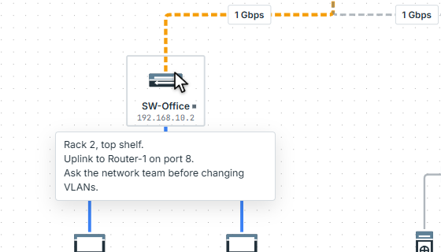

A note is a free text kept with a device, for what fits no field: whose desk it is, what is to be fixed, whom to ask. The network does not read it. It is for the person who looks at the drawing next.

## Writing a note {#write}

Open the window of the device with a double click. In the “General” tab, the last field under “Identity” is “Notes”. Type the text: as many lines as it takes, up to 2,000 characters. The field grows to fit what you write, to six lines, and scrolls after that. Press “Save”.

A note is kept trimmed, and a note you empty is no note at all. The note travels with the device: every kind of device has the field.

## Reading it {#read}



A device with a note shows a small square after its name. Rest the pointer on the device for a moment and a small panel opens under it, above it when there is no room below. The panel shows the lines as they were written; a note longer than six lines is cut after the sixth whole one. The same panel opens when the keyboard brings its focus to the device.

The panel never takes the pointer. It goes when the pointer leaves, when you press a button or turn the wheel, when a menu is opened, and with Esc. It does not show while a device is being dragged or a cable pulled. It is there in presentation mode too, where a note is something to read aloud. A screen reader hears the note from the device itself, and the small square is for the eye only.

The note is also in the exported image, as the small square, and not as text.

## Where it goes {#travels}

- **The project file** keeps it with the device (`notes`), and the YAML export and import do too, as one quoted line whatever it holds ([Project file](../reference/project-file.md), [YAML](../reference/yaml.md)).
- **Copy and paste** carry it: a pasted device has the note of the one it came from.
- **The terminal** prints it with `show config`:

```ncl fixture=building-office-notes
pixelcake> show config of SW-Office
SW-Office — Switch
  ip:       192.168.10.2
  subnet:   255.255.255.0
  gateway:  192.168.10.1
  location: Offices
  notes:    Rack 2, top shelf.
            Uplink to Router-1 on port 8.
  vlans:    none (untagged)
  ports:    8/8 enabled — "show ports SW-Office" for detail
```

The terminal has no command to write a note: it is written in the window of the device.

## Limits {#limits}

> [!LIMITS]
> - A note is plain text: no formatting, no links, no pictures.
> - The engine does not read a note: no answer changes because of one.
