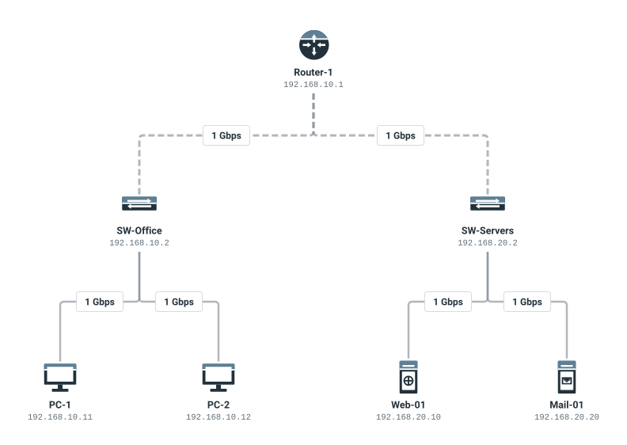

Five networks come with the app, already configured, so that there is something to ask questions of before anything is drawn. They are in the “Add” panel, under “Samples”; the welcome screen loads the first one with “Load the sample network”. Loading one replaces what is on the board, after the question “Load the sample network?”, and the network settings of the project become the sample's own: the network new devices start from, the gateway, the DNS server when there is one, and a name for each VLAN. The areas, the coloured rectangles that say what a group of devices is, come with every sample but the office.

A sample names its devices in the language the interface has when it is loaded, and keeps those names afterwards: the sales PC of the company is `PC-Sales` in English and `PC-Vendite` in Italian. The terminal speaks English in both languages. The pictures on this page are the board of each sample exported as an image, once for each language where the names differ.

The examples on this page run on the sample they follow. Each can be typed in the terminal ([the terminal](../terminal/index.md#open)) on a sample just loaded.

## Company {#company}

“Company: offices, Wi-Fi, servers and DMZ”: 20 devices and 20 links, in five areas (Internet, Edge, Core, Offices, Servers). The offices are in VLAN 10 and the Wi-Fi in VLAN 20, on one switch, with one trunk carrying both to the core; the servers are in VLAN 30 on a switch of their own, behind a third port of the router. Router-Core is also the DHCP server of the offices and of the Wi-Fi: the two laptops take their addresses from it. Srv-Auth is the DNS server of the inside, and knows the management software, the mail server and the customer portal by name. A firewall, FW-Edge, has a port for each zone, three rules, NAT towards the Internet and two port forwards that publish the portal and the mail server at its public address.


Things to try. A name works where an address does, because the PCs name Srv-Auth as their DNS server; and the portal in the DMZ cannot reach the inside, because no rule lets it:

```ncl sample=company
pixelcake> ping erp.company.example from PC-Sales
Looking up erp.company.example from PC-Sales (DNS server 192.168.30.10)...
  ✓ DNS request: PC-Sales → Srv-Auth
  ✓ DNS reply: Srv-Auth → PC-Sales
erp.company.example is 192.168.30.30 (answered by Srv-Auth)
Pinging Web-ERP (192.168.30.30) from PC-Sales...
Reply from 192.168.30.30: hops=6 time=9ms
pixelcake> ping Srv-Auth from Customer-Portal
Pinging Srv-Auth (192.168.30.10) from Customer-Portal...
Ping failed (blocked): request: firewall FW-Edge: no rule matches, zone policy dmz → trust denied
  dropped at: FW-Edge
```

Other questions the sample is made for: `show dhcp` lists the two pools and the two leases; `show vlans` ([VLANs](../building/vlans.md#trunk)) shows the trunk; `browse Customer-Portal from Remote-Customer` reaches the portal at its public address, through the port forward.

## Office {#office}

“Office: two networks and a router”: 7 devices and 6 links, no areas and no VLANs. Router-1 joins the offices (192.168.10.0/24: SW-Office, PC-1 and PC-2) to the servers (192.168.20.0/24: SW-Servers, Web-01 and Mail-01), and the port of the router in each network is the gateway of the devices of that network. It is the one to start with: every question about it has a clear answer. Its names are the same in both languages, so one picture serves both.



Things to try. Give a PC a gateway that is not the router and see the answer name it:

```ncl sample=office
pixelcake> ping Web-01 from PC-1
Pinging Web-01 (192.168.20.10) from PC-1...
Reply from 192.168.20.10: hops=5 time=7ms
pixelcake> set gateway of PC-1 to 192.168.10.254
PC-1: gateway set to 192.168.10.254
pixelcake> ping Web-01 from PC-1
Pinging Web-01 (192.168.20.10) from PC-1...
Ping failed (blocked): request: PC-1 uses gateway 192.168.10.254, but Router-1 port 1 on its network is 192.168.10.1
  dropped at: PC-1
```

The page on [VLANs](../building/vlans.md#vlan-1) takes this sample and splits it into VLANs port by port.

## Site {#site}

“Site: VLANs, DMZ and firewall”: 10 devices and 10 links, in three areas (Internet, DMZ, Internal network). The inside has two VLANs, offices (10) and servers (20), and Router-Core routes between them; its default route is the firewall. FW-Edge has a port for each zone and one rule: web from outside to the public web server in the DMZ. It does NAT on the port that faces the Internet, and one port forward publishes the web server at 203.0.113.1.


Things to try. The one rule, the page reached from outside through the published address, and the DMZ shut out of the inside:

```ncl sample=site
pixelcake> show rules FW-Edge
RULES of FW-Edge (the first that matches decides)
   1  allow web    from untrust            to 172.16.0.10
  then the zone policy: untrust → trust, untrust → dmz and dmz → trust denied, the rest allowed
  the reply to an allowed flow always passes
pixelcake> browse Web-Public from Remote-PC
Browsing Web-Public (203.0.113.1) from Remote-PC...
  ✓ HTTP request: Remote-PC → Web-Public
  ✓ HTTP response: Web-Public → Remote-PC
Page received from Web-Public
  note: HTTP request: Web-Public is behind NAT: reached at 203.0.113.1, where FW-Edge publishes it (port forward 1)
  note: HTTP request: Internet is not simulated: traffic assumed to pass
  note: HTTP request: firewall FW-Edge: allowed by rule 1 (allow web from untrust to 172.16.0.10)
  note: HTTP response: firewall FW-Edge: no rule matches, zone policy dmz → untrust allowed
  note: HTTP response: Internet is not simulated: traffic assumed to pass
pixelcake> ping Srv-Internal from Web-Public
Pinging Srv-Internal (192.168.20.10) from Web-Public...
Ping failed (blocked): request: firewall FW-Edge: no rule matches, zone policy dmz → trust denied
  dropped at: FW-Edge
```

## Two sites {#two-sites}

“Two sites: main line and backup line”: 12 devices and 13 links, in two areas (Head office, Branch). A router at each site, joined by a main line (1 Gbps) and, through a third router, a backup line (100 Mbps). At the head office three switches are closed in a ring. It is the sample for failures: nearly every cable has another way round, and the few that have none are worth finding. Each site router has two routes to the other site, the main line first and the backup second; the backup takes over when the interface of the main route has no working cable left.


Things to try. The two routes, then the path a ping takes while the main line is up:

```ncl sample=two-sites
pixelcake> show routes R-HQ
ROUTES of R-HQ
DESTINATION          VIA              OUT      KIND
10.0.0.0/30          -                port 2   connected
10.0.1.0/30          -                port 3   connected
192.168.1.0/24       -                port 1   connected
192.168.2.0/24       10.0.0.2         port 2   static
192.168.2.0/24       10.0.1.2         port 3   static, backup
pixelcake> trace PC-Branch-1 from PC-HQ-1
Tracing route to PC-Branch-1 (192.168.2.11) from PC-HQ-1:
  1  ○ PC-HQ-1 (PC)
  2  ○ SW-Floor-1 (Switch)
  3  ○ SW-Core (Switch)
  4  ○ R-HQ (Router)  — routed: 192.168.2.0/24 via 10.0.0.2 (port 2)
  5  ○ R-Branch (Router)  — routed: 192.168.2.0/24 is on port 1
  6  ○ SW-Branch (Switch)
  7  ● PC-Branch-1 (PC)
Trace complete: destination reached.
```

Then break it. The terminal cannot cut a cable: that is done in a presentation ([Presentation](../asking/presentation.md#failures)). Press “Present”, click the cable labelled “Main line” and choose “Simulate a failure”. The panel counts, over the 5 end devices, 20 exchanges that work without the failure: none stops, 12 take another path (the ones between the two sites, now through R-Backup) and 8 do not change.

## Multinational {#multinational}

“Multinational: ten sites in Italy”: 181 devices and 194 links, in the areas of ten sites. It is there to see how the app holds a drawing of that size, and to be questioned like a real network. Milan is the head office: two Internet providers, a firewall (FW-MI) with zones, NAT and eleven ordered rules, a DMZ, a server room and four floors. Rome and a disaster recovery data centre in Bologna reach it by a direct line, with the MPLS network of the carrier as backup. Seven branches reach it over MPLS: Turin, Venice, Florence, Naples, Cagliari, and two with a firewall of their own, a warehouse in Bari (cameras that talk only to their recorder, sensors that speak only to the archive) and a shop in Palermo (tills that reach only their server, guests kept away from the company). VLANs have the same number on every site: 10 users, 20 voice, 30 Wi-Fi, 40 guests, 60 cameras, 70 IoT, 80 tills. Routing is static, as everywhere in the app.


One site of it, the shop in Palermo, on its own:


Things to try. A trace from a PC in Rome to the ERP application in Milan takes the direct line of Rome, goes through the router of the WAN of Milan, and arrives; the tills of the shop reach their server by web and by nothing else; a guest cannot reach the cameras of the warehouse:

```ncl sample=multinational
pixelcake> trace ERP-APP from PC-RM-101
Tracing route to ERP-APP (10.10.100.20) from PC-RM-101:
  1  ○ PC-RM-101 (PC)
  2  ○ SW-RM-01 (Switch)  — VLAN 10
  3  ○ SW-RM-C (Switch)  — VLAN 10
  4  ○ R-RM (Router)  — routed: default route via 10.254.20.1 (port 4)
  5  ○ R-MI-WAN (Router)  — routed: default route via 10.10.255.5 (port 1)
  6  ○ R-MI (Router)  — routed: 10.10.100.0/24 is on port 4
  7  ○ SW-MI-DC (Switch)
  8  ● ERP-APP (Server)
Trace complete: destination reached.
pixelcake> browse POS-SRV from POS-PA-1
Browsing POS-SRV (10.10.100.40) from POS-PA-1...
  ✓ HTTP request: POS-PA-1 → POS-SRV
  ✓ HTTP response: POS-SRV → POS-PA-1
Page received from POS-SRV
  note: HTTP request: firewall FW-PA: allowed by rule 1 (allow web from 10.106.80.0/24 to 10.10.100.40)
  note: HTTP request: MPLS network is not simulated: traffic assumed to pass
  note: HTTP response: MPLS network is not simulated: traffic assumed to pass
  note: HTTP response: firewall FW-PA: no rule matches, zone policy trust → trust allowed
pixelcake> ping POS-SRV from POS-PA-1
Pinging POS-SRV (10.10.100.40) from POS-PA-1...
Ping failed (blocked): request: firewall FW-PA: denied by rule 2 (deny any from 10.106.80.0/24 to any)
  dropped at: FW-PA
pixelcake> ping CAM-BA-1 from Guest-PA-1
Pinging CAM-BA-1 (10.105.60.11) from Guest-PA-1...
Ping failed (blocked): request: firewall FW-PA: denied by rule 3 (deny any from 10.250.106.0/24 to 10.0.0.0/8)
  dropped at: FW-PA
```

Then break something, in a presentation: cut the cable labelled “Main line” between R-MI-WAN and R-RM, the main line of Rome. The panel counts, over the 132 end devices, 14,891 exchanges that work without the failure: none stops, 4,422 take another path (Rome through MPLS), 10,469 do not change. It takes a few seconds to work out.

> [!LIMITS]
> - A sample is a starting point, not a model of a real company. Its addresses are made for the example, and what it leaves out is what the app leaves out ([Limits and questions](limits-and-faq.md#not-simulated)).
> - Loading a sample replaces the board and the network settings of the project, with no undo. Save the project to a file before, if the board is worth keeping.
> - The Internet and the MPLS network are stand-ins: the engine says so in a note and lets traffic through. A real carrier is not simulated.
> - The language a sample is loaded in is the language of its device names for good: loading a sample in English and then switching the interface to Italian does not rename `PC-Sales`.
