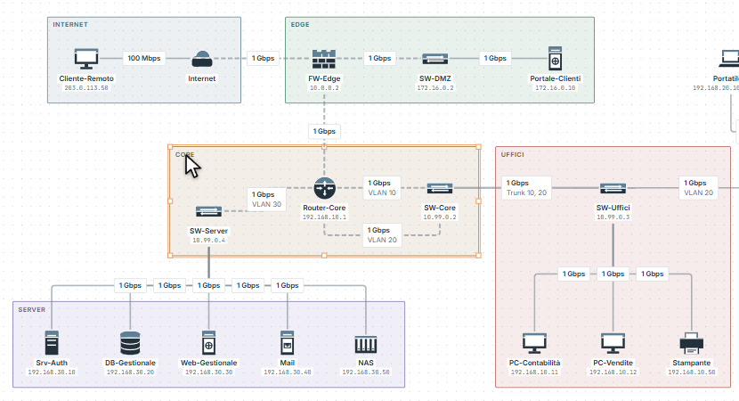

Un riquadro è un rettangolo colorato con un nome breve in un angolo, disegnato dietro a un gruppo di dispositivi per dire che cosa sono: Core, Edge, Uffici, Internet. Serve a chi legge il disegno. Le reti di esempio hanno già i loro, tutte tranne quella dell'ufficio.

## Che cos'è un riquadro {#what}

Un riquadro è un disegno e nient'altro. Nessun dispositivo gli appartiene: spostare un riquadro non sposta nessun dispositivo, e spostare un dispositivo non sposta il riquadro. Il motore non lo legge mai, quindi un PC disegnato dentro un riquadro chiamato Server non sta in nessuna rete di server, e un indirizzo, una VLAN o una regola non seguono il colore. Solo due funzioni guardano dove è disegnato un dispositivo: la [disposizione automatica](layout-and-connection.md#layout), che tiene insieme i dispositivi di un riquadro e lo ridisegna intorno a loro, e [il collegamento automatico](layout-and-connection.md#connect), che preferisce uno switch dello stesso riquadro.

Un riquadro non intralcia: dispositivi e cavi sono disegnati sopra di esso, un riquadro di selezione tracciato lì dentro prende i dispositivi e mai il riquadro, e selezionare, copiare, incollare ed eliminare dispositivi funziona come se il riquadro non ci fosse.

## Aggiungerne uno {#add}

Ci sono due modi:

- Nella barra a sinistra premi «Aggiungi dispositivo», e nel pannello «Aggiungi» scegli «Riquadro». Un riquadro viene aggiunto al centro della parte di canvas che stai guardando.
- Seleziona i dispositivi da racchiudere e scegli Modifica → «Racchiudi in un riquadro», oppure fai clic destro su uno di essi e scegli «Racchiudi in un riquadro». Il riquadro viene disegnato intorno ai dispositivi selezionati, con lo spazio per il suo nome. Dove quello spazio attraverserebbe un altro riquadro, o coprirebbe un dispositivo che non è nella selezione, si restringe, fino a un piccolo margine; un riquadro creato dentro un altro resta dentro.

In entrambi i casi il riquadro nuovo è selezionato e il suo nome è pronto per essere scritto. Scrivi il nome e premi Invio. Un nome è lungo al massimo 40 caratteri, tolti gli spazi in più. Un riquadro senza nome si vede come «Senza nome». Il riquadro prende un colore suo: tra i sei, quello usato meno finora sul canvas.

## Spostare, ridimensionare, rinominare {#edit}

- **Seleziona** un riquadro con un clic sul suo nome o sul suo bordo. Un clic all'interno non lo seleziona, così si possono raggiungere i dispositivi che contiene.
- **Spostalo** trascinando il suo nome o il suo bordo. I dispositivi restano dove sono.
- **Ridimensionalo** con le otto maniglie che mostra quando è selezionato. Non può diventare più piccolo di 120 per 80.
- **Rinominalo** con un doppio clic sul nome, oppure clic destro → «Rinomina». «Nome del riquadro» è il campo in cui scrivi; Invio conferma il nome, Esc lo lascia com'era.
- **Colore**: clic destro → «Colore», e scegli uno dei sei: Ardesia, Verde, Ocra, Rosso, Viola, Petrolio.
- **Eliminalo**: il tasto Canc (Delete), oppure clic destro → «Elimina», che chiede conferma. I dispositivi che racchiude restano dove sono.

I riquadri appartengono al loro canvas: ci restano quando passi a un altro canvas del progetto e poi torni, e si salvano nel file del progetto. L'esportazione YAML li contiene, con la posizione di ogni dispositivo. In una presentazione i riquadri si vedono ma non si possono toccare; la mappa piccola li mostra come rettangoli tenui, e l'immagine esportata li disegna, in chiaro e in scuro.

## Mostrarli e nasconderli {#show-hide}

Vista → «Mostra i riquadri» nasconde i riquadri e li mostra di nuovo. La voce è spuntata quando i riquadri si vedono, come all'inizio. La scelta è una preferenza di questo browser, tenuta insieme al tema: il disegno e il file del progetto non vengono toccati. Nascosti, i riquadri non sono disegnati sul canvas, nella sua mappa piccola, in una presentazione né nell'immagine esportata; non si possono selezionare, spostare o ridimensionare, e il tasto Canc non li raggiunge. Creare un riquadro nuovo li fa ricomparire, e un avviso lo dice.

## Limiti {#limits}

> [!LIMITS]
> - Un riquadro non è una rete, una sede né una VLAN: non ha indirizzo né impostazioni, e il motore non lo legge.
> - Un riquadro può essere disegnato dentro un altro, e la disposizione automatica ce lo lascia; non vuol dire altro.
