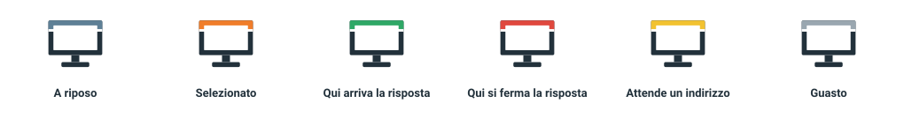

Un dispositivo è un pezzo del disegno: un PC, uno switch, un router, un server. Ognuno è disegnato con il suo nome sotto e, sotto il nome, il suo indirizzo. Un dispositivo nasce da un template, e PixelCake ne ha 24, uno per ciascun tipo qui sotto. Tutto ciò che il motore decide, dal fatto che un pacchetto attraversi o no un dispositivo all'indirizzo a cui corrisponde un nome, parte da ciò che è scritto sui dispositivi e sui cavi che li uniscono.

## I 24 tipi {#kinds}

I tipi si distinguono per due cose: se il dispositivo ha porte numerate o schede di rete, e che cosa fa il motore del traffico che non è per lui.

| Tipi | Porte o schede | Che cosa fa il motore del traffico che non è per il dispositivo |
|---|---|---|
| Router, Firewall | Porte, ciascuna con un indirizzo suo. Un firewall ha anche zone di sicurezza e regole | Lo inoltra da una rete all'altra, secondo la sua tabella di instradamento. Un firewall lo filtra anche |
| Switch | Porte, ciascuna in una VLAN o in un trunk | Lo inoltra dentro una rete sola, VLAN per VLAN |
| Access Point, IoT Gateway | Schede di rete | Lo inoltra dentro una rete sola, tra le sue schede |
| Load Balancer, Cloud | Schede di rete | Non è simulato: si considera che il traffico passi, e la risposta lo dice in una nota |
| Server, Mail Server, VPS, Web Server, Proxy Server, DNS Server, DHCP Server | Schede di rete | Nessuna: un dispositivo finale non porta mai il traffico degli altri |
| Database, Storage S3, NAS | Schede di rete | Nessuna |
| PC, Laptop, Smartphone, Tablet, IP Phone, Printer, IP Camera | Una scheda di rete | Nessuna |

I nomi sono quelli dei template, e sono gli stessi nelle due lingue. Che cosa dicono i disegni e i template:

- **Il disegno è ciò che distingue un tipo dall'altro.** Un web server e un mail server si distinguono per il simbolo che portano, e per ciò che il motore ne fa: un Mail Server è quello da cui passa la posta elettronica, e un server di qualunque tipo può fare da server DNS (la sua scheda «DNS») o assegnare indirizzi (la sua scheda «DHCP»). La pagina [Template](templates.md) spiega come si crea un tipo.
- **Un Cloud rappresenta ciò che sta fuori.** Un Cloud chiamato Internet è la rete Internet pubblica: non trasporta indirizzi privati, e un disegno che lo attraversa ha bisogno del NAT. Di ogni altro Cloud si considera che trasporti tutto ciò che gli viene mandato.
- **Solo i router e i firewall instradano.** Uno switch, un access point o un PC collegato non uniscono mai due reti: ci vuole un router o un firewall con una porta in ciascuna ([Indirizzi e gateway](addresses.md#router-ports)).

## Aggiungere un dispositivo {#add}

1. Nella barra a sinistra premi «Aggiungi dispositivo». Si apre il pannello «Aggiungi», con la scheda «Dispositivi».
2. Trova il tipo nell'elenco, o scrivi una parte del suo nome in «Cerca dispositivo…». Un clic apre una finestra intitolata "Aggiungi nuovo" e il nome del tipo, per esempio "Aggiungi nuovo Switch".
3. Controlla la finestra. In «Identità» ci sono il «Nome del dispositivo» (è proposto, vedi [Nomi](#names)) e, per uno switch, un router o un firewall, il «Numero di porte»: 5, 8, 16, 24 o 48 per uno switch, 2, 4, 8 o 16 per un router o un firewall. Vendor e posizione sono testo libero, per i dispositivi che non sono un PC. In «Rete» ci sono «Indirizzo IP», «Subnet mask» e «Gateway».
4. Premi «Aggiungi».

Il dispositivo compare al centro della parte di canvas che stai guardando, o nel posto libero più vicino, ed è selezionato. La finestra di un dispositivo finale riguarda la sua prima scheda di rete, `eth0`: l'indirizzo scritto lì è quello della scheda, e in «Indirizzo» si può scegliere «Automatico (DHCP)». Un router o un firewall non ha un indirizzo da compilare: le sue porte lo ricevono dopo, nella sua finestra ([Porte e schede di rete](ports-and-cards.md)).

L'indirizzo è il primo libero della rete del progetto, a partire da `.2`, con la subnet mask e il gateway di quella rete, e il server DNS se il progetto ne ha uno. Si impostano in Impostazioni → Rete, e [Indirizzi e gateway](addresses.md#project-network) spiega a che cosa serve ciascuno. Un indirizzo assegnato (cioè dato da un server DHCP) non viene mai proposto a un dispositivo nuovo.

Per aggiungere molti dispositivi in una volta ci sono [Aggiungi in blocco](bulk-add.md) e le reti di esempio, nella scheda «Esempi» dello stesso pannello.

## Nomi {#names}

Il nome di un dispositivo è come lo chiama una persona, e come lo chiama il terminale: `ping PC-2 from PC-1`. Un dispositivo nuovo prende il nome del suo template, con un trattino al posto di ogni spazio, e un numero: il più basso, da 1, che lasci il nome libero. Il primo PC è `PC-1`, il successivo `PC-2`, e un Web Server è `Web-Server-1`. Se elimini `PC-1`, il PC successivo sarà di nuovo `PC-1`. Un nome conta come occupato qualunque sia la sua grafia in maiuscole e minuscole, e qualunque sia il tipo del dispositivo che lo porta.

Il nome si cambia nella scheda «Generale» della finestra del dispositivo, sotto «Nome del dispositivo». Non può essere vuoto, ma PixelCake non ti impedisce di dare a due dispositivi lo stesso nome, e non rinomina quelli che ci sono già. Il terminale trova un dispositivo dal nome senza distinguere `pc-1` da `PC-1`; quando due dispositivi hanno lo stesso nome prende il primo, nell'ordine in cui sono stati disegnati. Un nome unico è un nome che funziona.

## La finestra di un dispositivo {#window}

Un doppio clic su un dispositivo ne apre la finestra, come fa il clic destro → «Dettagli (modifica)». La finestra è fatta di schede, e le schede dipendono dal tipo:

- «Generale»: il tipo, il «Nome del dispositivo», vendor e posizione, le «Note» ([Note](notes.md)), l'indirizzo e a che cosa è collegato il dispositivo. Per uno switch, un router e un firewall mostra anche come sono usate le porte.
- «Porte» per uno switch, un router e un firewall; «Schede di rete» per gli altri tipi. La pagina [Porte e schede di rete](ports-and-cards.md) parla di queste due.
- «Rotte» per un router e un firewall, «Regole» per un firewall, «NAT» per le porte di un router o di un firewall, «DHCP» per un router, un firewall e un server, «DNS» per un server.

Sul canvas non cambia nulla finché non premi «Salva»; «Annulla» lascia il dispositivo com'era.

## Copiare ed eliminare {#copy-delete}

- **Selezionare.** Un clic su un dispositivo lo seleziona. Ctrl + clic lo aggiunge alla selezione o lo toglie, e trascinando su uno spazio vuoto si disegna un riquadro di selezione.
- **Copiare.** Modifica → «Copia» o Ctrl+C copia i dispositivi selezionati, con i cavi che li uniscono. Modifica → «Incolla» o Ctrl+V aggiunge le copie, 50 unità più a destra e più in basso. Una copia tiene il nome e gli indirizzi del dispositivo da cui è nata: rinominala e dalle un indirizzo prima di chiedere qualcosa alla rete.
- **Eliminare.** Seleziona e premi il tasto Canc (Delete), che elimina subito, oppure clic destro → «Elimina», che chiede conferma. I cavi del dispositivo spariscono insieme a lui. Un dispositivo tolto dal canvas non torna: sul canvas non si può annullare.

## Il colore di un dispositivo {#lamp}

Lo strato superiore di ogni disegno è una spia. Il suo colore dice uno stato del dispositivo, e lo strato inferiore non cambia mai. Quando più stati sono veri insieme, si vede il primo di questo elenco.

| Colore | Il dispositivo è | Oltre al colore |
|---|---|---|
| Grigio | Considerato guasto, nella modalità presentazione | Un segno di guasto e testi sbiaditi |
| Rosso | Il punto in cui si ferma la risposta che è sullo schermo | Una cornice rossa; chi usa un lettore di schermo sente «Qui si ferma» |
| Verde | Il punto in cui arriva la risposta che è sullo schermo | Una cornice verde; chi usa un lettore di schermo sente «Qui arriva» |
| Arancione | Selezionato | La cornice della selezione |
| Giallo | In attesa di un indirizzo: la sua prima scheda è in DHCP e nessuno gliene ha dato uno | La riga sotto il nome dice «DHCP: nessun indirizzo» |
| Ardesia | Niente da dire | |

La risposta resta sul canvas dopo una domanda fatta dal pannello Simulazione o dal terminale (`ping`, `trace`, `browse`, `mail`, `download`), quando il pacchetto ha finito il suo percorso. Sparisce alla domanda successiva, a ogni modifica del disegno e con un clic su uno spazio vuoto. Se il pacchetto non riesce nemmeno a uscire dal primo dispositivo, la risposta compare subito. [Interrogare la rete](../asking/simulation-panel.md) e [Modalità presentazione](../asking/presentation.md) spiegano come fare una domanda, e che cosa fa un guasto simulato in presentazione.

## Limiti {#limits}

> [!LIMITS]
> - Il tipo decide il ruolo nel motore, e nient'altro dell'apparato: un dispositivo non ha modello, firmware, CPU o memoria, e nessun limite al traffico che porta.
> - Un Load Balancer non bilancia e un Cloud non trasporta nulla: di entrambi si considera che lascino passare il traffico.
> - Una stampante, una telecamera IP e gli altri dispositivi finali rispondono solo a ciò che il motore chiede loro; non eseguono servizi propri.
> - Due dispositivi possono avere lo stesso nome o lo stesso indirizzo, e il canvas non lo segnala.
