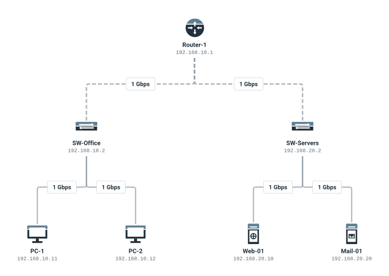
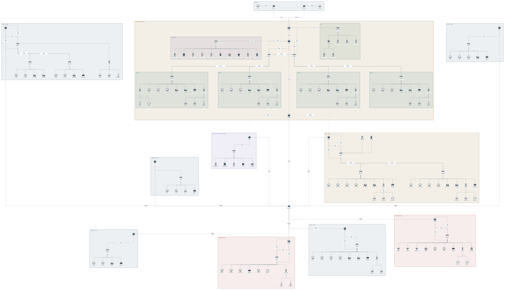

L'app ha cinque reti già configurate, per avere qualcosa a cui fare domande prima ancora di disegnare. Stanno nel pannello «Aggiungi», sotto «Esempi»; la schermata di benvenuto carica la prima con «Carica la rete di esempio». Caricarne una sostituisce ciò che c'è sul canvas, dopo la domanda «Caricare la rete di esempio?», e le impostazioni di rete del progetto diventano quelle dell'esempio: la rete da cui partono i dispositivi nuovi, il gateway, il server DNS quando c'è e un nome per ogni VLAN. I riquadri, i rettangoli colorati che dicono che cos'è un gruppo di dispositivi, ci sono in tutte le reti di esempio tranne quella dell'ufficio.

Una rete di esempio dà ai suoi dispositivi i nomi nella lingua che ha l'interfaccia quando la si carica, e poi li tiene: il PC delle vendite dell'azienda è `PC-Sales` in inglese e `PC-Vendite` in italiano. Il terminale parla inglese in tutte e due le lingue. Le immagini di questa pagina sono il canvas di ogni rete esportato come immagine, una per lingua dove i nomi cambiano.

I comandi di questa pagina usano la rete descritta subito prima. Ognuno si può provare nel terminale ([il terminale](../terminal/index.md#open)) su una rete di esempio appena caricata.

## Azienda {#company}

«Azienda: uffici, Wi-Fi, server e DMZ»: 20 dispositivi e 20 connessioni, in cinque riquadri (Internet, Edge, Core, Uffici, Server). Gli uffici sono nella VLAN 10 e il Wi-Fi nella VLAN 20, sullo stesso switch, con un trunk che porta tutte e due al core; i server sono nella VLAN 30 su uno switch a parte, dietro una terza porta del router. Router-Core è anche il server DHCP degli uffici e del Wi-Fi: i due portatili prendono da lui i loro indirizzi. Srv-Auth è il server DNS dell'interno, e conosce per nome il gestionale, il server di posta e il portale clienti. Un firewall, FW-Edge, ha una porta per ogni zona, tre regole, il NAT verso Internet e due inoltri che pubblicano il portale e il server di posta sul suo indirizzo pubblico.


Da provare. Un nome funziona dove funziona un indirizzo, perché i PC indicano Srv-Auth come loro server DNS; e il portale nella DMZ non raggiunge l'interno, perché nessuna regola glielo permette:

```ncl sample=company
pixelcake> ping gestionale.azienda.example from PC-Vendite
Looking up gestionale.azienda.example from PC-Vendite (DNS server 192.168.30.10)...
  ✓ DNS request: PC-Vendite → Srv-Auth
  ✓ DNS reply: Srv-Auth → PC-Vendite
gestionale.azienda.example is 192.168.30.30 (answered by Srv-Auth)
Pinging Web-Gestionale (192.168.30.30) from PC-Vendite...
Reply from 192.168.30.30: hops=6 time=9ms
pixelcake> ping Srv-Auth from Portale-Clienti
Pinging Srv-Auth (192.168.30.10) from Portale-Clienti...
Ping failed (blocked): request: firewall FW-Edge: no rule matches, zone policy dmz → trust denied
  dropped at: FW-Edge
```

Altre domande per cui questa rete è fatta: `show dhcp` elenca i due intervalli e i due indirizzi assegnati; `show vlans` ([VLAN](../building/vlans.md#trunk)) mostra il trunk; `browse Portale-Clienti from Cliente-Remoto` raggiunge il portale sul suo indirizzo pubblico, attraverso l'inoltro.

La prima volta che la carichi in un browser, dalla schermata di benvenuto o da «Esempi», un suggerimento in cima al canvas propone una prima domanda: se PC-Vendite raggiunge Web-Gestionale, con il comando `ping Web-Gestionale from PC-Vendite`. «Prova nel terminale» apre il terminale e lo esegue, e il pacchetto attraversa il canvas fino al server, che diventa verde. Il suggerimento arriva dopo il [tour guidato](../getting-started/interface.md#tour), quando il tour compare, si vede una volta sola e la sua crocetta lo chiude. Caricata in inglese, chiede `ping Web-ERP from PC-Sales`.

## Ufficio {#office}

«Ufficio: due reti e un router»: 7 dispositivi e 6 connessioni, senza riquadri e senza VLAN. Router-1 unisce gli uffici (192.168.10.0/24: SW-Office, PC-1 e PC-2) ai server (192.168.20.0/24: SW-Servers, Web-01 e Mail-01), e la porta del router in ogni rete è il gateway dei dispositivi di quella rete. È quella da cui cominciare: ogni domanda che la riguarda ha una risposta chiara. I suoi nomi sono uguali nelle due lingue, quindi basta un'immagine sola.



Da provare. Dai a un PC un gateway che non è il router, e guarda come la risposta lo nomina:

```ncl sample=office
pixelcake> ping Web-01 from PC-1
Pinging Web-01 (192.168.20.10) from PC-1...
Reply from 192.168.20.10: hops=5 time=7ms
pixelcake> set gateway of PC-1 to 192.168.10.254
PC-1: gateway set to 192.168.10.254
pixelcake> ping Web-01 from PC-1
Pinging Web-01 (192.168.20.10) from PC-1...
Ping failed (blocked): request: PC-1 uses gateway 192.168.10.254, but Router-1 port 1 on its network is 192.168.10.1
  dropped at: PC-1
```

La pagina sulle [VLAN](../building/vlans.md#vlan-1) prende questa rete e la divide in VLAN, porta per porta.

## Sede {#site}

«Sede: VLAN, DMZ e firewall»: 10 dispositivi e 10 connessioni, in tre riquadri (Internet, DMZ, Rete interna). L'interno ha due VLAN, uffici (10) e server (20), e Router-Core instrada tra l'una e l'altra; la sua rotta predefinita è il firewall. FW-Edge ha una porta per ogni zona e una regola sola: web da fuori verso il server web pubblico nella DMZ. Fa il NAT sulla porta rivolta a Internet, e un inoltro pubblica il server web su 203.0.113.1.


Da provare. L'unica regola, la pagina raggiunta da fuori attraverso l'indirizzo pubblicato, e la DMZ tenuta fuori dall'interno:

```ncl sample=site
pixelcake> show rules FW-Edge
RULES of FW-Edge (the first that matches decides)
   1  allow web    from untrust            to 172.16.0.10
  then the zone policy: untrust → trust, untrust → dmz and dmz → trust denied, the rest allowed
  the reply to a flow it allowed passes
pixelcake> browse Web-Pubblico from PC-Remoto
Browsing Web-Pubblico (203.0.113.1) from PC-Remoto...
  ✓ HTTP request: PC-Remoto → Web-Pubblico
  ✓ HTTP response: Web-Pubblico → PC-Remoto
Page received from Web-Pubblico
  note: HTTP request: Web-Pubblico is behind NAT: reached at 203.0.113.1, where FW-Edge publishes it (port forward 1)
  note: HTTP request: Internet is not simulated: traffic assumed to pass
  note: HTTP request: firewall FW-Edge: allowed by rule 1 (allow web from untrust to 172.16.0.10)
  note: HTTP response: firewall FW-Edge: no rule matches, zone policy dmz → untrust allowed
  note: HTTP response: Internet is not simulated: traffic assumed to pass
pixelcake> ping Srv-Interno from Web-Pubblico
Pinging Srv-Interno (192.168.20.10) from Web-Pubblico...
Ping failed (blocked): request: firewall FW-Edge: no rule matches, zone policy dmz → trust denied
  dropped at: FW-Edge
```

## Due sedi {#two-sites}

«Due sedi: linea principale e di riserva»: 12 dispositivi e 13 connessioni, in due riquadri (Sede, Filiale). Un router per sede, uniti da una linea principale (1 Gbps) e, attraverso un terzo router, da una linea di riserva (100 Mbps). Nella sede tre switch sono chiusi ad anello. È la rete per i guasti: quasi ogni cavo ha un'altra strada, e i pochi che non ce l'hanno vale la pena di trovarli. Ogni router di sede ha due rotte verso l'altra sede, la linea principale per prima e quella di riserva per seconda; la riserva subentra quando l'interfaccia della rotta principale non ha più nessun cavo che funzioni.


Da provare. Le due rotte, poi la strada che fa un ping finché la linea principale funziona:

```ncl sample=two-sites
pixelcake> show routes R-Sede
ROUTES of R-Sede
DESTINATION          VIA              OUT      KIND
10.0.0.0/30          -                port 2   connected
10.0.1.0/30          -                port 3   connected
192.168.1.0/24       -                port 1   connected
192.168.2.0/24       10.0.0.2         port 2   static
192.168.2.0/24       10.0.1.2         port 3   static, backup
pixelcake> trace PC-Filiale-1 from PC-Sede-1
Tracing route to PC-Filiale-1 (192.168.2.11) from PC-Sede-1:
  1  ○ PC-Sede-1 (PC)
  2  ○ SW-Piano-1 (Switch)
  3  ○ SW-Core (Switch)
  4  ○ R-Sede (Router)  — routed: 192.168.2.0/24 via 10.0.0.2 (port 2)
  5  ○ R-Filiale (Router)  — routed: 192.168.2.0/24 is on port 1
  6  ○ SW-Filiale (Switch)
  7  ● PC-Filiale-1 (PC)
Trace complete: destination reached.
```

Poi rompila. Il terminale non può tagliare un cavo: lo si fa in una presentazione ([Presentazione](../asking/presentation.md#failures)). Premi «Presenta», fai clic sul cavo con l'etichetta «Linea principale» e scegli «Simula un guasto». Il pannello conta, tra i 5 dispositivi finali, 20 comunicazioni che senza il guasto funzionano: nessuna si interrompe, 12 passano da un'altra strada (quelle tra le due sedi, ora per R-Riserva) e 8 non cambiano.

## Multinazionale {#multinational}

«Multinazionale: dieci sedi in Italia»: 181 dispositivi e 194 connessioni, nei riquadri di dieci sedi. Serve a vedere come l'app regge un disegno di quella dimensione, e a interrogarla come una rete vera. Milano è la sede centrale: due fornitori Internet, un firewall (FW-MI) con zone, NAT e undici regole in ordine, una DMZ, una sala server e quattro piani. Roma e un data center di disaster recovery a Bologna la raggiungono con una linea diretta, con la rete MPLS dell'operatore come riserva. Sette filiali la raggiungono sull'MPLS: Torino, Venezia, Firenze, Napoli, Cagliari, e due con un firewall proprio, un magazzino a Bari (telecamere che parlano solo con il loro registratore, sensori che parlano solo con l'archivio) e un negozio a Palermo (casse che raggiungono solo il loro server, ospiti tenuti lontani dall'azienda). Le VLAN hanno lo stesso numero in ogni sede: 10 utenti, 20 voce, 30 Wi-Fi, 40 ospiti, 60 telecamere, 70 IoT, 80 casse. L'instradamento è statico, come ovunque nell'app.



Una delle sedi, il negozio di Palermo, da sola:


Da provare. Un `trace` da un PC di Roma all'applicazione ERP di Milano prende la linea diretta di Roma, passa dal router della WAN di Milano e arriva; le casse del negozio raggiungono il loro server solo con il web; un ospite non raggiunge le telecamere del magazzino:

```ncl sample=multinational
pixelcake> trace ERP-APP from PC-RM-101
Tracing route to ERP-APP (10.10.100.20) from PC-RM-101:
  1  ○ PC-RM-101 (PC)
  2  ○ SW-RM-01 (Switch)  — VLAN 10
  3  ○ SW-RM-C (Switch)  — VLAN 10
  4  ○ R-RM (Router)  — routed: default route via 10.254.20.1 (port 4)
  5  ○ R-MI-WAN (Router)  — routed: default route via 10.10.255.5 (port 1)
  6  ○ R-MI (Router)  — routed: 10.10.100.0/24 is on port 4
  7  ○ SW-MI-DC (Switch)
  8  ● ERP-APP (Server)
Trace complete: destination reached.
pixelcake> browse POS-SRV from POS-PA-1
Browsing POS-SRV (10.10.100.40) from POS-PA-1...
  ✓ HTTP request: POS-PA-1 → POS-SRV
  ✓ HTTP response: POS-SRV → POS-PA-1
Page received from POS-SRV
  note: HTTP request: firewall FW-PA: allowed by rule 1 (allow web from 10.106.80.0/24 to 10.10.100.40)
  note: HTTP request: Rete MPLS is not simulated: traffic assumed to pass
  note: HTTP response: Rete MPLS is not simulated: traffic assumed to pass
  note: HTTP response: firewall FW-PA: no rule matches, zone policy trust → trust allowed
pixelcake> ping POS-SRV from POS-PA-1
Pinging POS-SRV (10.10.100.40) from POS-PA-1...
Ping failed (blocked): request: firewall FW-PA: denied by rule 2 (deny any from 10.106.80.0/24 to any)
  dropped at: FW-PA
pixelcake> ping CAM-BA-1 from Ospite-PA-1
Pinging CAM-BA-1 (10.105.60.11) from Ospite-PA-1...
Ping failed (blocked): request: firewall FW-PA: denied by rule 3 (deny any from 10.250.106.0/24 to 10.0.0.0/8)
  dropped at: FW-PA
```

Poi rompi qualcosa, in una presentazione: taglia il cavo con l'etichetta «Linea principale» tra R-MI-WAN e R-RM, la linea principale di Roma. Il pannello conta, tra i 132 dispositivi finali, 14.891 comunicazioni che senza il guasto funzionano: nessuna si interrompe, 4422 passano da un'altra strada (Roma passa dall'MPLS), 10.469 non cambiano. Ci mette qualche secondo a calcolarlo.

> [!LIMITS]
> - Una rete di esempio è un punto di partenza, non il modello di un'azienda vera. I suoi indirizzi sono fatti per l'esempio, e ciò che lascia fuori è ciò che l'app lascia fuori ([Limiti e domande](limits-and-faq.md#not-simulated)).
> - Caricare una rete di esempio sostituisce il canvas e le impostazioni di rete del progetto, e non si può annullare: i passi da annullare di quel canvas ripartono dalla rete di esempio. Salva prima il progetto su file, se il canvas merita di essere conservato.
> - Internet e la rete MPLS sono sostituti: il motore lo dice in una nota e lascia passare il traffico. Un operatore vero non è simulato.
> - I dispositivi di una rete di esempio tengono per sempre i nomi della lingua in cui è stata caricata: caricarla in inglese e poi passare l'interfaccia all'italiano non rinomina `PC-Sales`.
